# 실행 계획

## 상세 분석 요약

### 프로젝트 성격

- **프로젝트 유형**: Greenfield
- **기준 문서**: `docs/Function_Specification.md`, `requirements.md`, `personas.md`, `stories.md`
- **주요 목표**: 디시인사이드 공개 게시글/댓글 스크래퍼를 CLI, Python library, worker container, MCP tool로 사용할 수 있게 구현
- **1차 UI**: 터미널

### 변경 영향 평가

| 영향 영역 | 판단 | 내용 |
|---|---|---|
| 사용자 영향 | 있음 | CLI 작업 설정, 재개 명령, 출력 파일, 네트워크 설정 파일을 사용자가 직접 다룸 |
| 구조 영향 | 있음 | core library와 CLI/container/MCP adapter 분리가 필요 |
| 데이터 모델 영향 | 있음 | Job별 JSONL, 게시글 schema, 댓글/덧글, `(펌)` repost 객체가 필요 |
| API 영향 | 있음 | Python public API와 MCP tool 입력/출력 계약이 필요 |
| NFR 영향 | 있음 | 요청 속도, retry, checkpoint, CAPTCHA fail-closed, secret masking, structured logging 필요 |

### 위험 평가

- **Risk Level**: Medium
- **Rollback Complexity**: Easy
- **Testing Complexity**: Complex

**근거**

- Greenfield라 기존 운영 시스템 회귀 위험은 낮습니다.
- 디시인사이드 HTML/API 구조 의존, `(펌)` AJAX, 댓글 계층 파싱, 차단 감지 때문에 parser/test 복잡도는 높습니다.
- 1차 배포가 로컬/단일 컨테이너라 rollback은 이전 tag 또는 container image로 단순하게 처리할 수 있습니다.

## Workflow Visualization

```mermaid
flowchart TD
    Start(["User Request"])

    subgraph INCEPTION["INCEPTION PHASE"]
        WD["Workspace Detection<br/><b>COMPLETED</b>"]
        RE["Reverse Engineering<br/><b>SKIP</b>"]
        RA["Requirements Analysis<br/><b>COMPLETED</b>"]
        US["User Stories<br/><b>COMPLETED</b>"]
        WP["Workflow Planning<br/><b>COMPLETED</b>"]
        AD["Application Design<br/><b>EXECUTE</b>"]
        UG["Units Generation<br/><b>EXECUTE</b>"]
    end

    subgraph CONSTRUCTION["CONSTRUCTION PHASE"]
        FD["Functional Design<br/><b>EXECUTE</b>"]
        NFRA["NFR Requirements<br/><b>EXECUTE</b>"]
        NFRD["NFR Design<br/><b>EXECUTE</b>"]
        ID["Infrastructure Design<br/><b>EXECUTE</b>"]
        CG["Code Generation<br/><b>EXECUTE</b>"]
        BT["Build and Test<br/><b>EXECUTE</b>"]
    end

    subgraph OPERATIONS["OPERATIONS PHASE"]
        OPS["Operations<br/><b>PLACEHOLDER</b>"]
    end

    Start --> WD
    WD --> RE
    RE --> RA
    RA --> US
    US --> WP
    WP --> AD
    AD --> UG
    UG --> FD
    FD --> NFRA
    NFRA --> NFRD
    NFRD --> ID
    ID --> CG
    CG --> BT
    BT --> OPS
    OPS --> End(["Complete"])

    style Start fill:#CE93D8,stroke:#6A1B9A,stroke-width:3px,color:#000
    style End fill:#CE93D8,stroke:#6A1B9A,stroke-width:3px,color:#000
    style WD fill:#4CAF50,stroke:#1B5E20,stroke-width:3px,color:#fff
    style RA fill:#4CAF50,stroke:#1B5E20,stroke-width:3px,color:#fff
    style US fill:#4CAF50,stroke:#1B5E20,stroke-width:3px,color:#fff
    style WP fill:#4CAF50,stroke:#1B5E20,stroke-width:3px,color:#fff
    style RE fill:#BDBDBD,stroke:#424242,stroke-width:2px,stroke-dasharray: 5 5,color:#000
    style AD fill:#FFA726,stroke:#E65100,stroke-width:3px,stroke-dasharray: 5 5,color:#000
    style UG fill:#FFA726,stroke:#E65100,stroke-width:3px,stroke-dasharray: 5 5,color:#000
    style FD fill:#FFA726,stroke:#E65100,stroke-width:3px,stroke-dasharray: 5 5,color:#000
    style NFRA fill:#FFA726,stroke:#E65100,stroke-width:3px,stroke-dasharray: 5 5,color:#000
    style NFRD fill:#FFA726,stroke:#E65100,stroke-width:3px,stroke-dasharray: 5 5,color:#000
    style ID fill:#FFA726,stroke:#E65100,stroke-width:3px,stroke-dasharray: 5 5,color:#000
    style CG fill:#FFA726,stroke:#E65100,stroke-width:3px,stroke-dasharray: 5 5,color:#000
    style BT fill:#FFA726,stroke:#E65100,stroke-width:3px,stroke-dasharray: 5 5,color:#000
    style OPS fill:#BDBDBD,stroke:#424242,stroke-width:2px,stroke-dasharray: 5 5,color:#000
    linkStyle default stroke:#333,stroke-width:2px
```

## 실행할 단계

### INCEPTION PHASE

- [x] Workspace Detection - COMPLETED
- [x] Reverse Engineering - SKIP
  - **Rationale**: 기존 애플리케이션 코드가 없는 Greenfield 프로젝트입니다.
- [x] Requirements Analysis - COMPLETED
- [x] User Stories - COMPLETED
- [x] Workflow Planning - COMPLETED
- [ ] Application Design - EXECUTE
  - **Rationale**: core library, CLI, container, MCP adapter 경계와 module 구조를 먼저 정해야 합니다.
- [ ] Units Generation - EXECUTE
  - **Rationale**: parser, fetcher, search collector, worker runtime, checkpoint, output writer 등 구현 단위가 여러 개입니다.

### CONSTRUCTION PHASE

- [ ] Functional Design - EXECUTE
  - **Rationale**: 검색 수집, 게시글 상세, 댓글/덧글, `(펌)` AJAX, 저장 흐름의 동작 규칙이 필요합니다.
- [ ] NFR Requirements - EXECUTE
  - **Rationale**: Security, Resiliency, Property-Based Testing, 요청 속도, logging 요구를 구현 가능한 수준으로 구체화해야 합니다.
- [ ] NFR Design - EXECUTE
  - **Rationale**: retry, timeout, checkpoint, secret masking, test strategy를 설계해야 합니다.
- [ ] Infrastructure Design - EXECUTE
  - **Rationale**: 1차 범위에 worker container가 포함되어 있고, output/checkpoint/media volume 정책이 필요합니다.
- [ ] Code Generation - EXECUTE
  - **Rationale**: 실제 Python package, CLI, container, MCP adapter 구현이 필요합니다.
- [ ] Build and Test - EXECUTE
  - **Rationale**: fixture test, PBT, 선택적 live smoke test로 검증해야 합니다.

### OPERATIONS PHASE

- [ ] Operations - PLACEHOLDER
  - **Rationale**: 1차 구현 이후 배포/운영 문서화 단계입니다.

## 권장 진행 순서

1. Application Design
2. Units Generation
3. Functional Design
4. NFR Requirements
5. NFR Design
6. Infrastructure Design
7. Code Generation
8. Build and Test

## 예상 산출물

- Application Design: module 구조, adapter 경계, public API 초안
- Units Generation: 구현 단위 목록과 의존 관계
- Functional Design: 검색, 게시글, 댓글, `(펌)`, 저장, 재개 흐름 설계
- NFR Requirements/Design: 보안, 회복성, PBT, logging, rate limit 설계
- Infrastructure Design: container 실행 방식, volume/env/logging 정책
- Code Generation: Python package, CLI, tests, container/MCP adapter
- Build and Test: lint/test/build 결과와 미해결 위험 기록

## 성공 기준

- CLI로 게시글 URL, 갤러리 내 검색, 통합 검색, 심층검색, 노키워드 범위 수집 Job을 실행할 수 있다.
- 심층검색은 통합 검색으로 갤러리 후보를 만들고, 후보 갤러리별 키워드 검색으로 조건 범위 내 게시글을 수집할 수 있다.
- 환경변수로 실시간 키워드 수집과 실시간 전체 수집을 실행할 수 있다.
- core library는 import 부작용 없이 검색/게시글/댓글 fetch API를 제공한다.
- Job별 JSONL 결과가 게시글 단위로 append된다.
- 체크포인트에서 재개한 Job은 새 JSONL 파일에 중단점 이후 결과를 기록한다.
- 댓글/덧글, 디시콘, 이미지, `(펌)` repost 구조가 문서화된 schema로 저장된다.
- 작업 상태는 공통 checkpoint/status schema로 기록되며 게시글 10개 처리 완료마다 저장된다.
- CAPTCHA/차단 감지 시 우회 없이 `status="stopped"` checkpoint 저장 후 `job_id`를 출력하고 중단한다.
- 로컬 checkpoint는 `Checkpoint.json`, 컨테이너 checkpoint는 PostgreSQL, 컨테이너 JSONL 출력은 Garage 기반 S3 호환 오브젝트 스토리지를 사용한다. SeaweedFS는 대량 미디어/소파일 저장, FUSE, Iceberg 요구가 생길 때 확장 후보로 둔다.
- User-Agent, Proxy, 요청 속도, retry, structured logging이 적용된다.
- parser fixture test, Hypothesis PBT, 선택적 live smoke test 경로가 마련된다.

## 검토 필요 사항

- 모든 설계 단계를 실행하는 계획으로 작성했습니다.
- 유일한 skip 단계는 Greenfield라 필요 없는 Reverse Engineering입니다.
- 계획 승인 후 다음 단계는 Application Design입니다.
